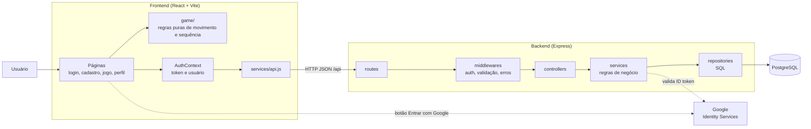
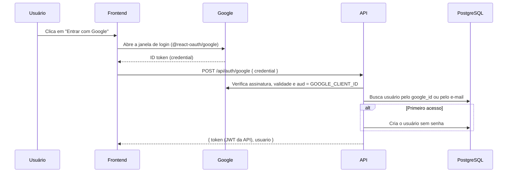

# Arquitetura do Sistema

## 1. Visão geral

A aplicação é dividida em três partes: o **frontend** em React, que roda no navegador; a **API REST** em Node.js com Express; e o **banco de dados** PostgreSQL. A autenticação pode ser feita com e-mail e senha ou com a conta Google. Nos dois casos, a API emite um token JWT próprio, que identifica o usuário nas requisições seguintes.

A movimentação do personagem é calculada inteiramente no navegador, por funções puras, sem depender do servidor (RNF04). O backend cuida apenas de contas, sessão e persistência.

## 2. Diagrama



## 3. Frontend

Estrutura de `frontend/src/`:

| Pasta ou arquivo | Responsabilidade | Situação |
|---|---|---|
| `main.jsx` | Ponto de entrada; monta o `App` | Existe |
| `App.jsx` | Hoje contém a tela do jogo inteira; deve passar a conter só as rotas | Existe |
| `pages/` | Telas: `LoginPage`, `CadastroPage`, `JogoPage`, `PerfilPage` | Vazia |
| `components/` | Peças reutilizáveis: `Grade`, `Personagem`, `Controles`, `ListaDeComandos` | Vazia |
| `contexts/` | `AuthContext`, que guarda o token e o usuário logado | Vazia |
| `hooks/` | Hooks como `useTeclado` e `useExecucao` | Vazia |
| `game/` | Regras puras do jogo (`move`, `runSequence`), sem React, testadas com Vitest | `movement.js` existe |
| `services/api.js` | Cliente HTTP da API; adiciona `Authorization: Bearer` quando há token | Existe |

Rotas de tela (React Router), a implementar:

| Rota | Tela | Exige sessão |
|---|---|---|
| `/login` | Login com e-mail/senha e botão Google | Não |
| `/cadastro` | Cadastro com nome, e-mail e senha, e botão Google | Não |
| `/playboard` | Área de movimentação e sequência de comandos | Sim |
| `/perfil` | Dados do usuário e botão Sair | Sim |

Em desenvolvimento, o Vite encaminha as chamadas a `/api` para `http://localhost:3001` (`vite.config.js`).

## 4. Backend

Estrutura de `backend/src/`:

| Pasta ou arquivo | Responsabilidade | Situação |
|---|---|---|
| `server.js` | Sobe o servidor na porta `PORT` | Existe |
| `app.js` | Cria o app Express: `helmet`, `cors`, JSON, rotas em `/api`, 404 e tratamento de erros | Existe |
| `config/env.js` | Lê e centraliza as variáveis de ambiente | Existe |
| `routes/` | Define as URLs e liga cada uma ao controller | `health` existe |
| `middlewares/` | `errorHandler` (existe), `autenticar` (valida o JWT) e `validar` (aplica um schema `zod`) | Parcial |
| `validators/` | Schemas `zod` dos corpos das requisições | Vazia |
| `controllers/` | Lê a requisição, chama o service e monta a resposta HTTP | Vazia |
| `services/` | Regras de negócio: hash de senha, emissão de JWT, validação do token Google | Vazia |
| `repositories/` | Consultas SQL parametrizadas usando o `pool` | Vazia |
| `database/pool.js` | Pool de conexões do `pg` | Existe |

Regra das camadas: cada camada só chama a camada logo abaixo. Controllers não escrevem SQL, e repositories não conhecem `req` nem `res`.

## 5. Contrato da API

Todas as rotas ficam sob `/api` e trocam JSON. Os erros seguem sempre o formato `{ "error": "mensagem" }`, gerado pelo `errorHandler`.

| Método e rota | Corpo | Resposta de sucesso | Erros | Situação |
|---|---|---|---|---|
| `GET /api/health` | — | `200 { "status": "ok" }` | — | Implementado |
| `POST /api/auth/register` | `{ nome, email, senha }` | `201 { token, usuario }` | `400` dados inválidos, `409` e-mail em uso | A implementar |
| `POST /api/auth/login` | `{ email, senha }` | `200 { token, usuario }` | `400`, `401` credenciais inválidas | A implementar |
| `POST /api/auth/google` | `{ credential }` (ID token do Google) | `200 { token, usuario }` | `400`, `401` token inválido | A implementar |
| `GET /api/users/me` | — (exige `Authorization: Bearer`) | `200 { usuario }` | `401` | A implementar |

O objeto `usuario` devolvido pela API tem o formato `{ id, nome, email, provedores: ["senha" | "google"] }`. Ele nunca inclui `senha_hash` nem `google_id`.

O logout não tem rota: como o JWT não guarda estado no servidor, o frontend apenas descarta o token (RF04).

## 6. Fluxos de autenticação

### 6.1 E-mail e senha

1. O usuário envia nome, e-mail e senha (cadastro) ou e-mail e senha (login).
2. O backend valida o corpo com `zod`.
3. No cadastro, gera o hash com `bcryptjs` e grava o usuário. No login, compara a senha com o hash guardado.
4. O backend assina um JWT com `JWT_SECRET`, validade `JWT_EXPIRES_IN` e o `id` do usuário no campo `sub`.
5. O frontend guarda o token no `AuthContext` e o envia como `Authorization: Bearer <token>`.

### 6.2 Google



### 6.3 Rotas protegidas

O middleware `autenticar` lê o cabeçalho `Authorization`, verifica o JWT e coloca o id do usuário em `req.usuarioId`. Sem token, com token adulterado ou com token expirado, responde `401`. Os repositories sempre filtram pelo `req.usuarioId` (RN09).

## 7. Modelo de dados

Proposta da tabela de usuários, a ser criada em `database/init.sql`:

```sql
CREATE TABLE usuarios (
  id          UUID PRIMARY KEY DEFAULT gen_random_uuid(),
  nome        VARCHAR(100) NOT NULL,
  email       VARCHAR(255) NOT NULL UNIQUE,
  senha_hash  TEXT,
  google_id   VARCHAR(255) UNIQUE,
  criado_em   TIMESTAMPTZ NOT NULL DEFAULT now(),
  CONSTRAINT usuario_tem_forma_de_acesso
    CHECK (senha_hash IS NOT NULL OR google_id IS NOT NULL)
);
```

| Coluna | Observação |
|---|---|
| `email` | Único (RN06). Guardar sempre em minúsculas. |
| `senha_hash` | Nulo para quem só usa Google. |
| `google_id` | Campo `sub` do ID token do Google. Nulo para quem só usa senha. |

As "atividades" citadas no RF13 ainda precisam ser definidas pela equipe. Quando forem, entram aqui como uma tabela ligada a `usuarios(id)` por chave estrangeira com `ON DELETE CASCADE`.

## 8. Segurança

- Senhas guardadas apenas como hash bcrypt (RNF05).
- `helmet` define cabeçalhos HTTP de segurança, e `cors` aceita apenas a origem `CORS_ORIGIN`.
- Todos os corpos de requisição são validados com `zod` antes de chegar ao service.
- Consultas SQL sempre parametrizadas (`$1`, `$2`), nunca montadas com concatenação de texto.
- O login com senha responde com a mesma mensagem para e-mail inexistente e senha errada.
- Erros 500 não expõem detalhes internos ao cliente (`errorHandler`).
- `.env` fora do git. Apenas os `.env.example`, sem valores reais, são versionados.
- Variáveis `VITE_*` vão para o navegador, então nunca contêm segredos.

## 9. Variáveis de ambiente

| Variável | Onde | Uso |
|---|---|---|
| `PORT` | backend | Porta da API (padrão 3001) |
| `NODE_ENV` | backend | `development`, `test` ou `production` |
| `CORS_ORIGIN` | backend | Origem permitida (endereço do frontend) |
| `DATABASE_URL` | backend | Conexão com o PostgreSQL |
| `JWT_SECRET` | backend | Segredo para assinar os tokens de sessão |
| `JWT_EXPIRES_IN` | backend | Validade do token (padrão `1d`) |
| `GOOGLE_CLIENT_ID` | backend | Valida o `aud` do ID token do Google |
| `VITE_API_URL` | frontend | URL base da API (padrão `/api`) |
| `VITE_GOOGLE_CLIENT_ID` | frontend | Client ID usado pelo botão do Google |
