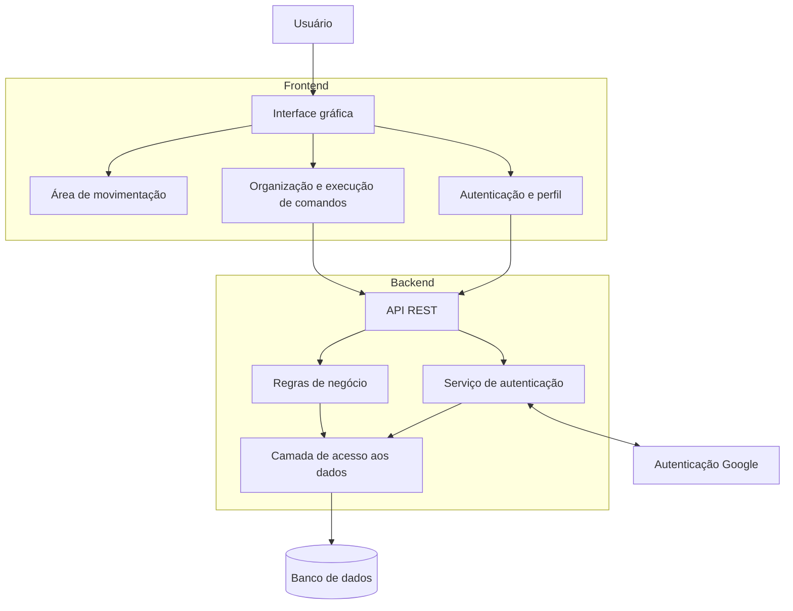

# Arquitetura do Sistema

## 1. Visão Geral

O sistema consiste em uma ferramenta visual e interativa para o ensino lúdico de lógica e programação. O usuário poderá criar uma conta, autenticar-se e movimentar um personagem em uma área delimitada por meio de comandos direcionais.

A arquitetura será organizada em camadas, separando a interface do usuário, as regras de negócio, o acesso aos dados e os mecanismos de autenticação. Essa separação busca facilitar a manutenção e a realização de testes automatizados.

## 2. Arquitetura Proposta

A arquitetura será composta pelas seguintes camadas:

- **Frontend:** responsável pela interface gráfica, interação com o usuário, exibição do personagem e organização dos comandos.
- **Backend:** responsável pelo processamento das requisições, aplicação das regras de negócio, autenticação e comunicação com o banco de dados.
- **Banco de dados:** responsável por armazenar as informações dos usuários e os dados associados às suas atividades.
- **Serviço de autenticação Google:** responsável por permitir que o usuário acesse o sistema por meio de sua conta Google.

## 3. Componentes do Sistema

### 3.1 Frontend

O frontend será responsável por apresentar as funcionalidades ao usuário e permitir a interação com o personagem.

Suas principais responsabilidades serão:

- Apresentar as telas de cadastro, login e perfil do usuário.
- Exibir a área delimitada de movimentação e a posição atual do personagem.
- Permitir a movimentação por meio de botões direcionais e das setas do teclado.
- Impedir visualmente que o personagem ultrapasse os limites da área.

### 3.2 Backend

O backend será responsável por processar as requisições recebidas do frontend e aplicar as regras de negócio do sistema.

Suas principais responsabilidades serão:

- Receber e validar os dados enviados pela interface.
- Realizar o cadastro e a autenticação dos usuários.
- Validar a autenticação realizada por meio do Google.
- Controlar o acesso aos dados de cada usuário.

### 3.3 Banco de Dados

O banco de dados será utilizado para armazenar as informações necessárias ao funcionamento do sistema.

Inicialmente, serão considerados os seguintes dados:

- **Usuários:** identificador, nome, e-mail, informações necessárias à autenticação e tipo de autenticação utilizado.

### 3.4 Serviço de Autenticação Google

O sistema oferecerá a opção de autenticação por meio de uma conta Google. O fluxo de autenticação será integrado ao backend, que deverá validar as informações ou credenciais recebidas antes de permitir o acesso às funcionalidades protegidas.

## 4. Fluxo de Comunicação

A comunicação entre frontend e backend ocorrerá por meio de requisições HTTP, utilizando uma API REST e dados no formato JSON.

O fluxo geral será:

1. O usuário realiza uma ação na interface.
2. O frontend processa a interação e, quando necessário, envia uma requisição ao backend.
3. O backend valida a requisição e executa as regras de negócio correspondentes.
4. Quando necessário, o backend consulta ou atualiza o banco de dados.
5. O backend retorna uma resposta ao frontend.
6. O frontend atualiza a interface conforme o resultado recebido.

A movimentação imediata do personagem poderá ser processada no próprio frontend, pois não depende necessariamente de comunicação com o servidor. A persistência de dados e as operações relacionadas à conta do usuário dependerão do backend.

## 5. Tecnologias Propostas

As seguintes tecnologias são consideradas para a implementação inicial:

| Componente | Tecnologia proposta | Finalidade |
|---|---|---|
| Frontend | React.js | Construção da interface interativa |
| Linguagem do frontend | JavaScript | Implementação dos componentes e interações |
| Backend | Node.js com Express | Criação da API e processamento das requisições |
| Comunicação | API REST e JSON | Integração entre frontend e backend |
| Banco de dados | PostgreSQL | Persistência dos dados |
| Autenticação externa | Google OAuth 2.0 / OpenID Connect | Acesso por conta Google |
| Controle de versão | Git e GitHub | Versionamento e colaboração |
| Automação de testes | Vitest, React Testing Library e Playwright | Testes unitários, de integração e ponta a ponta |

## 6. Segurança e Persistência

A arquitetura deverá considerar os seguintes aspectos:

- Validar os dados recebidos pelo backend.
- Proteger as rotas e operações que exigem autenticação.
- Garantir que cada usuário acesse somente os dados aos quais tem autorização.
- Armazenar senhas utilizando uma função de hash apropriada.
- Manter credenciais e chaves de serviços externos em variáveis de ambiente.
- Não versionar arquivos `.env` com credenciais reais.
- Tratar falhas de autenticação, indisponibilidade do banco e erros nas requisições.

## 7. Diagrama de Arquitetura

